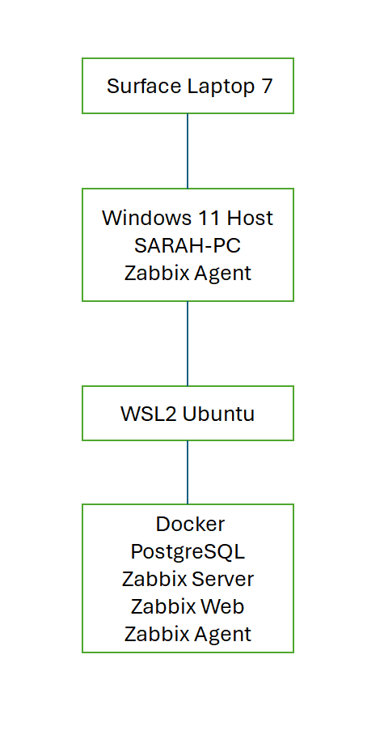
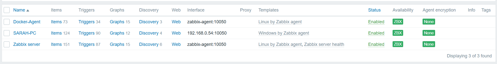
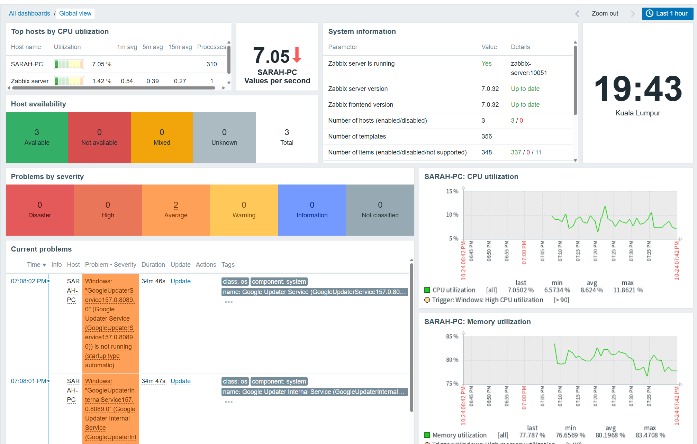
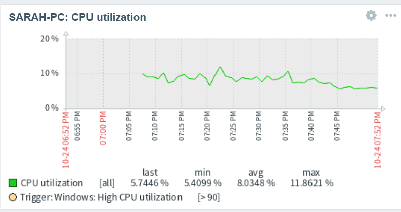
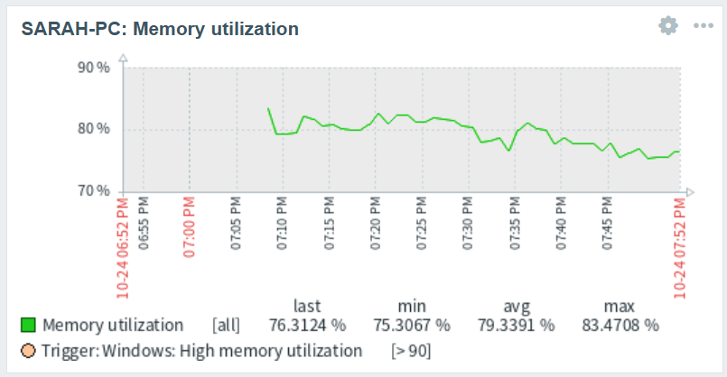

# Zabbix Monitoring Lab on Surface Laptop 7 (ARM64)

## Overview

This project demonstrates the deployment and configuration of a complete Zabbix monitoring environment on a Microsoft Surface Laptop 7 (ARM64) using Docker, WSL2, Ubuntu, PostgreSQL, and Windows Agent monitoring.

The objective of this project was to gain hands-on experience with:

- Infrastructure Monitoring
- Zabbix Administration
- Docker Containerization
- Linux Administration
- Windows Agent Deployment
- Network Troubleshooting

---

## Environment

### Hardware

| Component | Details |
|------------|------------|
| Device | Surface Laptop 7 |
| Architecture | ARM64 |
| Operating System | Windows 11 |

### Software Stack

| Component | Version |
|------------|------------|
| Docker Desktop | Latest |
| WSL2 | Enabled |
| Ubuntu | WSL Distribution |
| PostgreSQL | 16 |
| Zabbix Server | 7.0 LTS |
| Zabbix Web | 7.0 LTS |
| Zabbix Agent | Windows Agent |
| Zabbix Agent 2 | Docker Agent |

---

## Architecture

### Architecture Diagram



### Logical Architecture

```text
Surface Laptop 7 (Windows 11 ARM64)
│
├── Windows Host
│   ├── Hostname: SARAH-PC
│   └── Zabbix Agent
│
└── WSL2 Ubuntu
    │
    └── Docker
        ├── PostgreSQL
        ├── Zabbix Server
        ├── Zabbix Web Frontend
        └── Zabbix Agent 2
```

---

## Docker Deployment

The monitoring environment was deployed using Docker Compose.

Services deployed:

- PostgreSQL
- Zabbix Server
- Zabbix Web Frontend
- Zabbix Agent 2

Deployment command:

```bash
docker compose up -d
```

Verification command:

```bash
docker ps
```

---

## Monitored Hosts

### Docker-Agent

Monitoring Metrics:

- CPU Utilization
- Memory Utilization
- Filesystem Usage
- Network Statistics
- System Uptime

### SARAH-PC

Monitoring Metrics:

- CPU Usage
- RAM Usage
- Disk Space
- System Uptime
- Network Activity
- Windows Performance Metrics

---

## Screenshots

### Host Monitoring

All monitored hosts successfully communicating with Zabbix.



### Dashboard Overview

Real-time monitoring dashboard.



### CPU Monitoring

CPU utilization monitoring.



### Memory Monitoring

Memory utilization monitoring.



---

## Challenges and Troubleshooting

### Issue 1 - Connection Refused

Error:

```text
Cannot establish TCP connection
Connection refused
```

Root Cause:

```text
Host interface was configured as 127.0.0.1
```

Resolution:

Updated host interface to:

```text
192.168.0.54
```

---

### Issue 2 - Agent Access Permission

Error:

```text
Received empty response from Zabbix Agent.
Assuming that agent dropped connection because of access permissions.
```

Root Cause:

```text
Windows Agent only accepted connections from localhost.
```

Resolution:

Updated:

```text
Server=172.20.160.1
```

inside:

```text
zabbix_agentd.conf
```

and restarted the Windows Zabbix Agent service.

---

### Issue 3 - Docker Network Communication

Problem:

```text
Docker containers could not communicate through localhost.
```

Resolution:

Configured correct network interfaces and host addressing between:

- Docker containers
- WSL2
- Windows Host

---

## Skills Demonstrated

### Monitoring

- Zabbix Server Administration
- Host Configuration
- Agent Deployment
- Dashboard Configuration
- Performance Monitoring

### Linux Administration

- Ubuntu
- WSL2
- System Services
- Network Diagnostics

### Docker

- Docker Compose
- Container Deployment
- Container Networking
- Service Management

### Windows Administration

- Windows Services
- Agent Configuration
- Firewall Verification
- Port Verification

### Troubleshooting

- TCP Connectivity
- Agent Configuration
- Access Permissions
- Host Interface Configuration
- Docker Networking

---

## Repository Structure

```text
zabbix-monitoring-lab/
│
├── README.md
├── docker-compose.yml
│
├── screenshots/
│   ├── hosts-green-status.png
│   ├── dashboard-overview.png
│   ├── cpu-graph.png
│   └── memory-graph.png
│
└── diagrams/
    └── architecture-diagram.png
```

---

## Future Improvements

Planned enhancements:

- Email Alerting
- Grafana Integration
- SNMP Monitoring
- Network Discovery
- Low-Level Discovery (LLD)
- API his project I gained practical experience in:

- Infrastructure Monitoring
- Docker Deployment
- Linux Administration
- Windows Administration
- Performance Monitoring
- Network Troubleshooting
- Zabbix Administration

This project demonstrates the ability to deploy, configure, monitor, and troubleshoot a modern monitoring platform using open-source technologies.

---

## Author

**Maisarah**

Environmental Engineer transitioning into IT Infrastructure, System Administration, Monitoring, and Data Analytics.
